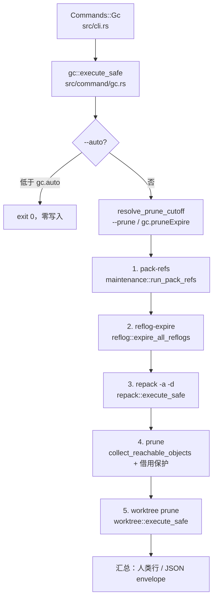

# `libra gc` 开发设计

## 命令实现目标

`libra gc` 是 Git 兼容的仓库垃圾回收命令（ADR-MX-07），目标是把 Git `gc` 的维护步骤组合为一个公开命令：pack-refs、reflog 过期、`repack -a -d`、宽限期外不可达松散对象删除与 worktree prune。实现的核心约束是**复用既有维护原语**——可达性清单、alternates 借用保护、pack 写入器与维护锁全部来自 `maintenance`/`repack`/`reflog`/`worktree`，`gc` 本身不写任何新的可达性遍历。

## 对比 Git 与兼容性

- 兼容级别：`partial`。步骤顺序与 `git gc` 一致（`builtin/gc.c` 的 pack-refs → reflog expire → repack → prune → worktree prune）。
- 已支持：`--prune=<date>` / `--no-prune`（缺省 `gc.pruneExpire`，默认 `2.weeks.ago`；`now`/`never`/裸整数天数/`N.<unit>.ago` 点分 approxidate/RFC3339/`YYYY-MM-DD`）、`--auto`（低于 `gc.auto`（默认 6700）零写入 exit 0，`gc.auto <= 0` 禁用，与 Git `too_many_loose_objects` 一致）、`--aggressive`（接受并在 `--json` envelope 报告；加大窗口随 MX-09 的 `repack --window/--depth` 落地）、全局 `--quiet` 与 `--json`/`--machine`。
- 安全：可达对象绝不删除；删除步骤在存在活跃 alternates 借用方时拒绝（`LBR-CONFLICT-002`，沿用维护 gc 的借用保护）；删除前在独占维护锁下复核可达性，先删 `object_index` 行再 unlink 载荷。
- 有意收窄：不做 cruft pack、commit-graph、bitmap；`repack -a -d` 的冗余 *pack* 删除随 MX-08 落地；`--aggressive` 的窗口参数随 MX-09 落地。
- 退出码：0（完成，含 `--auto` 跳过）；129（非法 `--prune`、`--prune` 与 `--no-prune` 冲突）；128（运行期失败）。
- 新增语义必须同步 [`COMPATIBILITY.md`](../../../COMPATIBILITY.md)、用户文档 [`docs/commands/gc.md`](../../commands/gc.md) 与 zh-CN、测试。

## 设计方案

- 入口与分发：`src/cli.rs::Commands::Gc`（可见命令，`after_help = GC_EXAMPLES`），分发到 `command::gc::execute_safe`。注册命中 T-1（src/cli.rs）。
- 源码分层：
  - `src/command/gc.rs`：参数（`GcArgs`）、步骤编排、`--auto` 门、prune 策略解析（`resolve_prune_cutoff`）、不可达松散对象删除（`prune_unreachable_loose`）、人类/JSON 汇总（`GcStep`/`GcOutput`）。
  - 复用：`maintenance::{run_pack_refs, collect_reachable_objects, list_loose_objects, parse_object_hash, cleanup_empty_dirs}`、`reflog::expire_all_reflogs`（`gc.reflogExpire`/`gc.reflogExpireUnreachable` 默认策略，不 `--rewrite`/`--updateref`/`--stale-fix`）、`repack::execute_safe`（`all + delete`）、`worktree::execute_safe`（`Prune`）、`internal::maintenance_lock::MaintenanceLock`、`internal::alternates::ensure_no_live_borrowers`、`utils::client_storage::remove_object_index_rows_with_conn`。
- 关键正确性：
  - **`--auto` 零写入**：先 `list_loose_objects` 计数，低于阈值直接 exit 0，不触碰任何锁或写路径。
  - **prune 前置校验**：`resolve_prune_cutoff` 在任何步骤写入之前解析 `--prune`/`gc.pruneExpire`，非法值以 `LBR-CLI-002`（129）失败，保证失败发生在零写入点。
  - **删除三阶段**：候选收集（可达性过滤 + mtime 宽限期）→ 独占维护锁 + 借用方复核 + 可达性重扫 → 先删 `object_index` 行再 unlink 载荷、最后 `cleanup_empty_dirs`。`try_exclusive` 失败时延后删除（不报错），与维护 gc 一致。
  - **子步骤静默**：`silent_child` 屏蔽各子命令自身输出，`gc` 独占人类汇总与 JSON envelope，避免嵌套 envelope。
  - **松散对象过期语义**：Git prune 只在 `st_mtime > expire` 时保留对象，即 `mtime <= cutoff` 时删除（含同一秒，`--prune=now` 也删除刚写入对象），与 `prune.c` 一致。

## 实现历史

- 2026-10-20（MX-07）：注册公开命令并按 ADR-MX-07 实现步骤编排、`--auto`、prune 策略与借用保护；`docs/commands/gc.md` 与 zh-CN 由「unpublished 设计」改为正式命令文档；`_compatibility.md` 关闭 `gc` 治理项；`COMPATIBILITY.md` 新增 `gc` 行。
- 历史结论：当前文档以这些提交之后的代码、测试和兼容矩阵为准。

## 当前状态

- 公开状态：已公开；模块状态：已导出。
- 用户文档：`docs/commands/gc.md`（EN）、`docs/commands/zh-CN/gc.md`。
- Synopsis：`libra gc [--prune=<date>] [--no-prune] [--aggressive] [--auto]`（`--quiet` 与 `--json`/`--machine` 为全局标志）。
- 公开参数：`--prune <DATE>`、`--no-prune`、`--aggressive`、`--auto`。
- 判据矩阵：M-GC G1（新仓库 exit 0）、G2（可达对象打包 + 过期不可达删除）、G3（`--prune=now` / `--no-prune`）、G4（`--auto` 阈值零写入）、G5（`--quiet`/`--aggressive`/`--json`）、G6（alternates 借用保护回归）。
- 测试：`tests/command/gc_test.rs`（L1，`command_test::gc_test::*`）：`test_gc_matrix_g1_fresh_repo`、`test_gc_matrix_g2_packs_reachable_and_prunes_expired`、`test_gc_matrix_g3_prune_now_and_no_prune`、`test_gc_matrix_g4_auto_threshold_zero_writes`、`test_gc_matrix_g5_quiet_aggressive_json`、`test_gc_matrix_g6_alternates_borrow_protection`、`test_gc_matrix_prune_argument_validation`、`test_gc_matrix_prune_expiry_forms`。

## 还未实现的功能

- `--aggressive` 的加大 delta 窗口：随 MX-09（`repack --window/--depth` 与 `gc.aggressiveWindow`/`gc.aggressiveDepth`）落地；当前该标志被接受并在 JSON envelope 报告。
- 冗余 pack 删除：随 MX-08（`repack -a -d` 的 pack 生命周期）落地。
- cruft pack、commit-graph、bitmap、顶层 `prune` 命令（DEFER-04）：本计划外。
